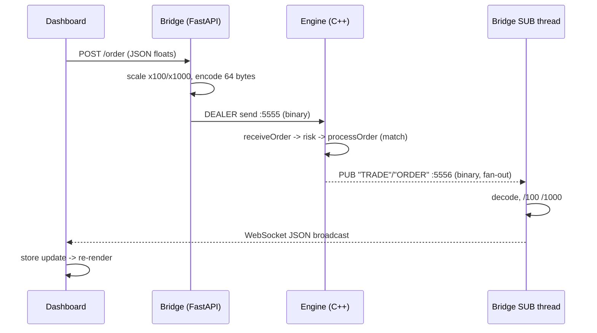
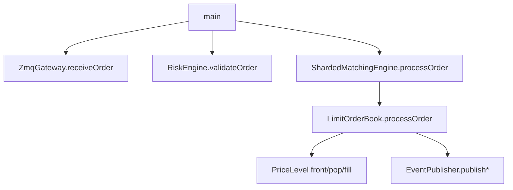

# Full-Stack Reference

The final companion doc. It covers what the others don't:

- **Part 1** — advanced **C++ concepts** you'll hit while rebuilding the engine (move semantics,
  iterator invalidation, ADL, PMR allocator propagation, ODR/inline, undefined behavior).
- **Part 2** — the **C++ test suites**: what each one guards and why.
- **Part 3** — the **Python bridge** (`bridge/`), function by function.
- **Part 4** — the **`services/core` backend** (pure-Python trading engine), class by class.
- **Part 5** — the **`services/api` HTTP layer**, module by module.
- **Part 6** — the **Next.js dashboard** (`dashboard/src/`), file by file.
- **Part 7** — **data-flow diagrams** (Mermaid).
- **Part 8** — a chronological **"empty repo → running system"** recap.

Read `REPLICATION_GUIDE.md`, then `docs/cpp-engine-reference.md`, then this.

---

# Part 1 — Advanced C++ concepts (the tricky bits)

These trip up newcomers. Understand each before you touch the corresponding code.

## 1.1 Value categories, copies, and moves

- Every C++ expression is an **lvalue** (has a name/address, e.g. `order`) or an **rvalue**
  (temporary, e.g. `Price{15025}`).
- A **copy** duplicates an object; a **move** transfers its guts (e.g. steals a vector's buffer),
  leaving the source empty. Moves are cheap for containers.
- `std::move(x)` doesn't move anything — it just *casts* `x` to an rvalue so a move constructor is
  chosen. In `StrongType(T val) : value_(std::move(val))`, `std::move` lets a movable `T` be moved
  into `value_` instead of copied (harmless for `int64_t`, valuable if `T` were expensive).
- **Why it matters here:** the engine deliberately avoids copies on the hot path by passing
  `Order*`/`const Order&` and by using `std::pmr::vector` you build once. If you accidentally pass
  `Order` by value, you copy 64 bytes per call — measurable at these latencies.

## 1.2 Iterator invalidation (why the cancel trick is safe)

Different containers invalidate iterators differently — this is the rule set the O(1) cancel relies
on:
- **`std::list`**: inserting or erasing elements **does not** invalidate iterators to *other*
  elements. So the `OrderListIterator` the book saved when the order was added stays valid even as
  other orders are added/removed at that price. That's what makes "jump straight to this node and
  erase it" correct later.
- **`std::map`**: inserting never invalidates existing iterators; erasing invalidates only the
  iterator to the erased element. So holding `asks_.begin()` across a `matchLevel` call is fine
  until you `erase` that level (after which you must not reuse it — the code re-fetches `begin()`).
- **`std::unordered_map`**: rehash (on growth) invalidates *iterators* but **not** references/pointers
  to elements. The book stores an `OrderEntry` *by value* in the lookup map and looks it up fresh
  each cancel, so rehash is a non-issue.
- **`std::vector`**: reallocation invalidates **everything**. That's why the trades vector is
  `reserve`d up front and never grown mid-match.

**Takeaway:** the container choices in §Part 2 of the engine reference aren't arbitrary — they're
chosen so the exact iterators the book keeps remain valid for the operations it performs.

## 1.3 Argument-Dependent Lookup (ADL) and the `std::hash` specialization

When you call `std::hash<OrderId>{}(id)`, the compiler must find a `hash` specialization for
`OrderId`. The project provides one by **opening `namespace std`** and specializing
`std::hash<chronos::StrongType<T, Tag>>`. This is one of the *very few* things you're allowed to add
to `namespace std` (specializing a template for your own type). Without it, `std::unordered_map<
OrderId, ...>` wouldn't compile. Note it's declared *outside* `namespace chronos`, at the bottom of
`strong_type.hpp`.

## 1.4 `std::pmr` allocator propagation (a subtle correctness rule)

When you construct a `std::pmr` container you pass a `memory_resource*`. Important rules:
- The resource is **not** copied when the container is copied/assigned by default — pmr containers do
  **not** propagate their allocator on copy assignment. So don't assume two pmr containers share a
  pool just because one was assigned from the other.
- A `PriceLevel`'s `orders_` list gets the pool resource via its constructor
  (`orders_(resource)`), and the book obtains that resource from `bids_.get_allocator().resource()`
  when creating new levels (`try_emplace(price, price, bids_.get_allocator().resource())`) — i.e. the
  level inherits the *same* pool the map uses. Get this wrong and a level would allocate from the
  default heap, defeating the zero-alloc goal.
- Because monotonic resources never free individual objects, pmr containers built on them must not
  be long-lived churn buffers; here they're per-symbol books (long-lived, bounded) and per-call trade
  vectors (short-lived) — both fine.

## 1.5 ODR, `inline`, and why header-only works

The **One Definition Rule (ODR)** says a function may be defined once across the program — normally.
Two escape hatches make header-only legal:
- Functions defined **inside a class body** (all the engine methods) are implicitly `inline`.
- Free functions in headers are marked `inline` (e.g. `pinThreadToCore`).
`inline` here means "may be defined in multiple translation units, the linker will merge them" — not
"please inline for speed" (though the compiler may). Since Chronos has a single translation unit
(`main.cpp`), ODR is trivially satisfied anyway; the discipline matters if you later add `.cpp` files.

## 1.6 Undefined behavior (UB) catalog to avoid

UB is where the compiler assumes something can't happen and optimizes accordingly; violating it
gives silent, timing-dependent corruption — deadly in a trading engine.
- **Signed integer overflow** is UB. Prices/quantities are `int64_t`; keep values well within range.
- **Reading uninitialized memory** is UB. `Order` fields must be set before use; the padding bytes
  are the only "don't care" region (but zero them if you hash/compare whole structs).
- **Dangling pointer dereference** is UB. See the "resting order on the stack" gotcha — pool-allocate
  resting orders.
- **`reinterpret_cast`/`memcpy` type punning**: copying raw bytes onto an `Order` is legal only
  because `Order` is a *trivially copyable* aggregate. Keep it trivially copyable (no virtuals, no
  custom copy) or the `std::copy`-onto-struct in the gateway becomes UB.
- **Data races** are UB. Only the atomics cross threads; never share the book or a socket.

## 1.7 Templates & `constexpr` (compile-time work)

- `StrongType<T, Tag>` and `MemoryPool::allocate<T>()` are **templates**: the compiler stamps out a
  concrete version per type you use. Errors appear at instantiation, which is why template error
  messages are long.
- `constexpr` on `StrongType`'s constructor/accessors lets prices be computed at **compile time**
  where possible (e.g. constant limits), and guarantees no runtime cost.

## 1.8 The ZeroMQ wire, in bytes

A ROUTER receive for one order looks like this on the socket (frames are length-delimited by ZMQ):
```
frame 0: <client identity>       (opaque bytes ZMQ assigns to the DEALER peer)
frame 1: <empty>                 (present if the peer is a REQ/DEALER using an envelope)
frame 2: <64 bytes = the Order>  (raw struct)
```
A PUB send for a trade is two frames: `["TRADE"][64-byte Trade]`. The `ZMQ_SNDMORE` flag on the
first frame tells ZMQ "more frames follow — deliver them atomically." SUB sockets match the topic by
**prefix**, so subscribing to `"TRADE"` gets `TRADE...` frames.

---

# Part 2 — The C++ test suites (what each guards)

Each `tests/test_*.cpp` is a GoogleTest suite; together they lock the engine's invariants. Rebuild
them alongside the modules — a module isn't "done" until its suite is green.

- **`test_types.cpp` (CoreTypesTest)** — `sizeof(Order)==64`, `alignof==64`, same for `Trade`; strong
  types reject mixing; struct fields round-trip. *Guards the wire layout and type safety.*
- **`test_memory_pool.cpp` (MemoryPoolTest)** — allocation advances the pool; pmr containers built on
  it work. *Guards zero-alloc plumbing.*
- **`test_price_level.cpp` (PriceLevelTest)** — FIFO order, add/remove/fill/pop, `total_quantity`
  stays correct. *Guards the queue invariant.*
- **`test_lob.cpp` (LOBTest)** — best bid/ask tracking, resting, cancel (O(1) via lookup), level
  removal when emptied. *Guards book bookkeeping.*
- **`test_matching.cpp` (MatchingTest)** — full cross, partial fill, no-cross rests, FIFO within a
  level, price priority across levels, trade prints at passive price. *Guards the algorithm.*
- **`test_sharding.cpp` (ShardingTest)** — routing by symbol; unknown symbol returns empty.
- **`test_risk.cpp` (RiskEngineTest)** — oversize qty/notional and non-positive price rejected;
  normal order passes.
- **`test_gateway.cpp` (ZmqGatewayTest)** — a well-formed 64-byte frame decodes to the right `Order`.
- **`test_publication.cpp` (PublicationTest)** — publishing a trade/order emits the right topic +
  bytes (a SUB test socket reads them back).
- **`test_audit.cpp` (AuditLoggerTest)** — the logger thread persists published events to file.
- **`test_wire_codec.cpp` (WireCodecTest)** — the standalone C++ codec encodes the **exact golden
  bytes** and round-trips; binary-compatible with `chronos::Order`. *Guards the cross-language
  contract.*
- **`benchmark_matching.cpp` (MatchingBenchmark)** — a throughput/latency sanity check.

---

# Part 3 — The Python bridge (`bridge/`)

Translates binary↔JSON and serves the web. Build order: `schemas` → `wire` → `main` → `feeder`.

## 3.1 `schemas.py`
Pydantic models + enums — the data shapes crossing the HTTP boundary.
- `OrderSide(IntEnum)`: `BUY=0, SELL=1`. `OrderStatus(IntEnum)`: `NEW=0 … REJECTED=4`. Values match
  the C++ enums (part of the wire contract).
- `Order`: `id, symbol(≤8), price:int, quantity:int, side, status, timestamp` — **scaled integers**,
  the engine's representation.
- `Trade`: `buy_order_id, sell_order_id, price, quantity, timestamp`.
- `OrderRequest`: the *API* shape from the browser — `symbol, price:float, quantity:float, side`.
  Prices/quantities here are human floats; the bridge scales them.

## 3.2 `wire.py` (single source of truth for bytes + scaling)
- Constants: `MESSAGE_SIZE=64`, `SYMBOL_SIZE=8`, `PRICE_SCALE=100`, `QUANTITY_SCALE=1000`.
- Format strings: `ORDER_FORMAT="<Q8sqqBB6xQ16x"`, `TRADE_FORMAT="<QQqqQ24x"` — must mirror the C++
  layout exactly (`<` = little-endian; `6x`/`16x`/`24x` = padding).
- `make_symbol(str)->bytes` / `symbol_to_string(bytes)->str` — encode/trim the 8-byte NUL-padded
  symbol.
- `scale_price/scale_quantity` use **`round()`** (not `int()`, which truncates: `int(0.29*100)==28`).
  `unscale_*` divide back.
- `encode_order(Order)->bytes` / `decode_order(bytes)->Order`; `encode_trade`/`decode_trade`. Each
  validates `len==64` and packs/unpacks with the format strings.
- **Gotcha:** any change to the C++ struct requires the matching change here or the length check fails
  and decoding silently stops. A golden test (`bridge/tests/test_wire.py`) asserts the exact bytes.

## 3.3 `decoder.py`
A thin backward-compatibility shim that re-exports from `wire.py`, so older
`from bridge.decoder import decode_order` imports keep working. New code imports `bridge.wire`.

## 3.4 `main.py` (FastAPI app)
- Global ZMQ **DEALER** socket connected to `tcp://localhost:5555` (to send orders to the engine).
- `POST /order`: takes `OrderRequest` (floats), scales via `wire.scale_*`, builds an `Order`,
  `encode_order`, sends the 64 bytes on the DEALER socket. Returns the assigned order id.
- Background **daemon thread** (`zmq_listener`): SUBscribes to `tcp://localhost:5556` (topics
  `TRADE`, `ORDER`), decodes each event, and pushes JSON to all WebSocket clients via
  `asyncio.run_coroutine_threadsafe(manager.broadcast(...), loop)` — the safe hand-off from a plain
  thread into the asyncio loop.
- `WebSocket /ws`: the dashboard connects here for the live JSON feed; `ConnectionManager` tracks
  clients and broadcasts.
- CORS is enabled so the dashboard (different origin) can call the REST endpoint.
- On startup, optionally spawns `feeder.py` as a **subprocess** if `START_FEEDER=1`.

## 3.5 `feeder.py` (market-data driver)
- Connects to Finnhub's WebSocket (`wss://ws.finnhub.io?token=$FINNHUB_API_KEY`).
- `SYMBOL_MAP` maps external symbols (`BINANCE:BTCUSDT`) to engine symbols (`BTC`, ≤8 chars).
- On each live trade, `synthesize_and_send_orders` scales price/qty and sends a **buy+sell pair** to
  `:5555` to force an execution in the engine (so the UI shows live activity).
- Runs as its own process (isolated from the API) with reconnect/backoff.

---

# Part 4 — `services/core` (pure-Python trading backend)

An **optional second implementation** of the *business logic* in plain Python (no C++/ZMQ), for
learning. Each module has a `unittest` suite. Build order mirrors the C++ engine, then adds the
broker layers on top.

## 4.1 `money.py`
Fixed-point helpers shared everywhere. `PRICE_SCALE=100`, `QUANTITY_SCALE=1000`;
`notional_cents(price, qty, multiplier=1)` = order value in cents (the `multiplier` handles option
contracts, e.g. ×100); `to_price/to_quantity/from_cents` convert at the edges.

## 4.2 `reference_data.py`
The instrument master. `Instrument` dataclass (symbol, kind equity|option, tick, lot, and for
options: underlying, expiry, strike, right, multiplier). `ReferenceData` registers/looks up
instruments, lists an option `chain(underlying)`, and holds a simple trading calendar
(`is_trading_day`). *Equities default multiplier 1; options 100.*

## 4.3 `ledger.py` (double-entry accounting)
`Ledger` keeps an **append-only journal** of balanced postings and derives balances by replay.
- `post(txn_id, legs)` — legs must sum to zero (double-entry); **idempotent** by `txn_id`.
- `fund/transfer` — helpers that build balanced legs (a virtual `EXTERNAL` account keeps the whole
  ledger summing to zero — a strong invariant you can test).
- `reserve/release` (buying-power **holds**): set aside cash when an order is placed, free it on
  fill/cancel. `available = balance − reserved`.

## 4.4 `matching.py` (the venue — same algorithm as the C++ engine)
`OrderBook` = price-time-priority book in ~80 readable lines: `add_limit` (matches then rests),
`match_market` (sweeps with no price limit; **cash-bounded** for buys so it can't overspend),
`fillable_qty` (for fill-or-kill), `remove` (cancel), `rest` (matchless insert used to rebuild the
book on restart). `Venue` = one book per symbol. Read this next to the C++ `limit_order_book.hpp` —
it's the same idea without the systems difficulty.

## 4.5 `risk.py`
`RiskConfig` (max qty, max notional) + `RiskEngine` with `check(...)` (static rules + buying-power +
kill switch) and `check_market(qty)` (no notional cap; affordability enforced by cash-bounded
matching). Returns a `RiskResult(ok, reason)`.

## 4.6 `portfolio.py`
`Position` (qty, cost basis, realized P&L) and `Portfolio` tracking positions per (account, symbol);
`on_fill` updates cost basis and realized P&L (long-only cost model); `unrealized_cents(mark)`;
`holdings(account)`, `holders(symbol)`.

## 4.7 `oms.py` (Order Management System — the orchestrator)
`Order` dataclass (id, account, symbol, side, price, qty, status, filled, tif, order_type,
stop_price, fills). `OMS.place(...)` runs the **placement saga**: validate → reserve buying power →
risk check → route to the venue → settle each fill (cash transfer + position update + record trade)
→ re-sync the buying-power hold to the resting remainder. Also: `cancel` (release hold, pull from
book), `place_combo` (atomic multi-leg), TIF (GTC/IOC/FOK), order types (limit/market/stop/
stop-limit) with a **cascade-safe stop-trigger loop** on last trade price, plus persistence hooks
(`_restore`, `_save`) and an optional `EventBus`/`TradeLog`/`AlertEngine`.

## 4.8 Supporting modules
- `trades.py` — `TradeLog`: durable, monotonic-`seq` record of executions; the seq doubles as a
  collision-free settlement transaction id; `for_account/for_symbol`.
- `alerts.py` — `AlertEngine`: one-shot above/below price alerts fired on each trade.
- `corporate_actions.py` — `CorporateActions`: splits (scale qty, keep basis) and cash dividends.
- `surveillance.py` — self-trade/wash detection over the trade log.
- `ohlc.py` — `build_bars`: aggregate ticks into OHLCV candles.
- `statements.py` — reconcile an account's cash postings + trades + positions.
- `pricing.py` — Black-Scholes price, Greeks (Δ, Γ, V, Θ, ρ), implied vol (bisection); pure math.
- `market_data.py` — provider-abstracted ingest (Mock + Finnhub adapters) → normalized trades.
- `event_bus.py` — in-process pub/sub (per-subscriber bounded queues) driving SSE.
- `persistence.py` — SQLite `Database`: journal, holds, orders, positions, trades tables; the OMS/
  ledger/portfolio replay from it on startup so state survives restart.

---

# Part 5 — `services/api` (HTTP layer, stdlib only)

## 5.1 `app.py` — `TradingApp` facade
Wires all `services/core` objects and exposes human-friendly operations (floats in, dollars out):
`add_equity/add_option`, `fund/balance/positions/orders/cashflow`, `place_order/place_combo/
cancel_order/get_order`, `book/snapshot/markets/instruments`, `trades/symbol_trades`, `add_alert/
alerts_for`, `apply_split/apply_dividend`, `statement`, `run_surveillance`, `ohlc`, `price_option/
position_greeks`. Converts between API floats and engine fixed-point at this boundary.

## 5.2 `server.py` — stdlib HTTP + SSE
- `route(app, method, parts, body, query)` — a big if-ladder mapping paths to `TradingApp` calls;
  raises map to 404/400/500.
- `_Handler` (`BaseHTTPRequestHandler`): `_begin` (timing + correlation id), `_cors` (allowlist),
  `_authorized` (optional bearer token on mutating methods), `_rate_ok` (token bucket), `_send/
  _send_html/_send_text` (+ structured access log + metrics), `do_GET` (serves `/`, `/metrics`,
  `/stream`, else dispatch), `_stream` (SSE with optional `?symbols=` filter), `do_POST/do_DELETE`
  (auth + rate-limit gate then dispatch), `do_OPTIONS` (CORS preflight).
- `_Server(ThreadingHTTPServer)` — `daemon_threads`, quiet `handle_error` (ignores benign client
  disconnects). `make_server(...)` attaches `app`, `api_token`, `cors_origins`, `metrics`,
  `rate_limiter`. `__main__` reads `config`, installs SIGTERM/SIGINT graceful shutdown.

## 5.3 `config.py`, `metrics.py`, `ratelimit.py`, `web.py`
- `config.py` — 12-factor env: `PORT, CHRONOS_DB, CHRONOS_CORS_ORIGINS, CHRONOS_API_TOKEN,
  CHRONOS_RATE_LIMIT`.
- `metrics.py` — `Metrics` (request counter) + `render_prometheus(...)` (counters + business gauges).
- `ratelimit.py` — `RateLimiter` token bucket (per client IP; disabled at 0).
- `web.py` — the served zero-build HTML dashboard string (polls the REST/SSE endpoints).

---

# Part 6 — The Next.js dashboard (`dashboard/src/`)

## 6.1 State & data access
- `store/useTradeStore.ts` (Zustand) — global state: `bids/asks/trades/last/bestBid/bestAsk`,
  `selectedSymbol/account/symbols`, `balance/positions/orders`, `toasts`, `defaultQty`; actions
  `applySnapshot` (book+tape from a backend snapshot), `applyAccount`, `pushToast/dismissToast`,
  setters. Values arrive already unscaled from the API.
- `lib/api.ts` — typed REST client (`getSnapshot/getInstruments/getMarkets/getBalance/getPositions/
  getOrders/getCashflow/getStatement/getSurveillance/getChain/placeOrder/placeCombo/cancelOrder/
  fundAccount/addEquity/addOption/positionGreeks`) + `subscribeStream` (SSE via `EventSource`).
  Base URL from `NEXT_PUBLIC_API_BASE`.
- `lib/scaling.ts` — the TS copy of the ×100/×1000 convention (kept in lockstep with C++/Python).

## 6.2 Pages
- `app/page.tsx` — the terminal: header (symbol tabs, last/bid/ask, live status, nav, `?` help),
  order ticket + account summary + watchlist (left), chart + tabbed Orders/Tape/Depth (center),
  tabbed Book/Ladder + Positions/Greeks/Cash (right). Wires the SSE+poll refresh loop, order-status
  toasts, keyboard shortcuts, and localStorage prefs.
- `app/options/page.tsx` — options chain + spread builder + Greeks panel.
- `app/compliance/page.tsx` — surveillance alerts + account statement.

## 6.3 Components (each reads the store / calls the API client)
`OrderBook` (depth bars), `PriceLadder` (click-to-trade), `TradeTape`, `PriceChart` (candles via
`lightweight-charts`), `DepthChart` (cumulative SVG), `OrderEntry` (all order types + TIF + fund/
seed), `AccountSummary`, `Positions`, `OpenOrders` (+ cancel), `CashCurve` (equity curve),
`GreeksPanel`, `OptionsChain`, `SpreadBuilder`, `Watchlist`, `Toaster`.

---

# Part 7 — Data-flow diagrams

## 7.1 One order, end to end (C++ path)


## 7.2 Threads in the engine process
```mermaid
flowchart LR
    subgraph Engine process
      M[Main/matching thread<br/>pinned core 1, RT prio<br/>receive->risk->match] -- PUB :5556 --> Q[(ZMQ)]
      A[Audit thread<br/>own ctx+socket<br/>SUB -> disk] <-- SUB :5556 --- Q
      IO[ZMQ I/O threads]
    end
    F[flag: atomic bool] -. read/write .-> M
    F -. read/write .-> A
```

## 7.3 In-process call graph (engine)


---

# Part 8 — Empty repo → running system (chronological recap)

1. **Set up** CMake (C++20, `-Werror`, GoogleTest, ZeroMQ) and the folder skeleton.
2. **`strong_type.hpp`** → **`types.hpp`**; write `test_types.cpp`; assert `sizeof==64`. 
3. **`memory_pool.hpp`** (+ test) — the zero-alloc pool.
4. **`price_level.hpp`** (+ test) — the FIFO queue.
5. **`limit_order_book.hpp`** (+ matching/LOB tests) — the algorithm. This is the milestone; if
   matching is correct and tested, the hard part is done.
6. **`sharded_matching_engine.hpp`** (+ test) — per-symbol routing.
7. **`risk_engine.hpp`** (+ test) — pre-trade gate.
8. **`event_publisher.hpp` / `zmq_gateway.hpp`** (+ publication/gateway tests) — the network edge.
9. **`audit_logger.hpp` / `thread_utils.hpp` / `latency_utils.hpp`** — the support cast + threading.
10. **`src/main.cpp`** — wire it all and run the hot loop.
11. **Lock the wire contract** (`contracts/WIRE_FORMAT.md`, `test_wire_codec.cpp`, golden bytes).
12. **Bridge**: `schemas` → `wire` (+ `bridge/tests/test_wire.py`) → `main` → `feeder`.
13. **Dashboard**: store → `lib/api` → `page.tsx` (WebSocket/SSE) → components.
14. **(Bonus)** `services/core` then `services/api` — the pure-Python backend + HTTP/SSE + the rich
    dashboard screens; run `python3 -m unittest discover -t . -s services -p "test_*.py"`.
15. **Run everything** (engine :5555/:5556, bridge :8000, dashboard :3000) and watch one order flow
    all the way through. When it does — you've replicated Chronos.

*Cross-references: `REPLICATION_GUIDE.md` (build order & concepts),
`docs/cpp-engine-reference.md` (class-by-class + standards),
`docs/deepdive-communication-and-threading.md` (comms, `main()`, threads).*
